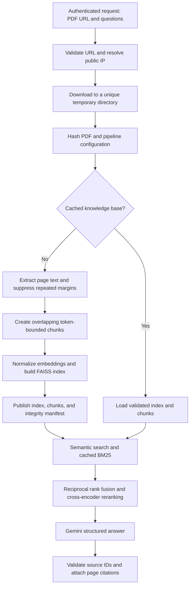

# Insurance Policy RAG System

[](https://github.com/mohitgupta2006-create/RAG-SYSTEM/actions/workflows/ci.yml)

A FastAPI service that answers questions about a PDF using hybrid retrieval, cross-encoder reranking, and Google Gemini. Answers include citations assembled from actual document metadata. The service accepts one public PDF URL and up to 20 questions per request.

This repository includes regression tests, bounded downloads, content-addressed caching, and Docker support. It is a prototype with explicit limitations; it does not guarantee that a generated insurance interpretation is correct.

## Architecture



Indexing happens on the first request for a document. Later requests reuse its disk or memory cache, but still download the PDF to verify its content hash. Questions are embedded in one batch and answered sequentially, preserving request order.

## Improvements in this version

- Single-page PDFs retain their content. Repeated headers and footers are identified only in page margins and must appear on multiple distinct pages.
- PDF text blocks retain page boundaries. Chunk overlap follows tokenizer offsets, with a limit below the embedding model's input length.
- Citations use one-based PDF page numbers and the current URL's filename, without its query string. List content never merges across pages.
- Normalized FAISS vectors provide cosine ranking. BM25 indexes are reused, and rank fusion uses stable chunk IDs.
- Downloads have a byte limit, timeouts, PDF-signature checks, redirect validation, and optional hostname allowlists. Connections are pinned to a validated public IP while preserving HTTPS certificate verification.
- Cache keys include the PDF hash, embedding model name, page limit, and pipeline version. Checksums detect incomplete or corrupted cache pairs; file locks prevent duplicate builds.
- A bounded memory LRU limits loaded documents. Requests use isolated temporary directories and clean them up on both success and failure.
- Blocking work runs in FastAPI's thread pool. Admission limits return a retryable response when the service is busy.
- Structured generation validates cited chunk IDs. Provider failures return HTTP errors instead of being included as successful answers.
- Startup loads configuration and models explicitly; importing the API does not download models or require credentials. Logs include request IDs, status, and timing without signed document URLs or question text.

## Requirements

- CPython 3.12 or 3.13. Local verification uses Python 3.12; CI is configured for both versions.
- A Google Gemini API key and an available text-generation model that supports structured JSON output.
- Internet access for PDF downloads, Gemini, and the first download of embedding/reranking models.
- Enough memory for PyTorch, the embedding model, the optional reranker, and document indexes. Dependency and model downloads can be large.

The Gemini model is deliberately configurable, with no hardcoded default. Select a currently available model from Google's [model documentation](https://ai.google.dev/gemini-api/docs/models), and check its [deprecation schedule](https://ai.google.dev/gemini-api/docs/deprecations).

## Local setup

```bash
git clone https://github.com/mohitgupta2006-create/RAG-SYSTEM.git
cd RAG-SYSTEM
python -m venv .venv
```

Activate the environment on Windows PowerShell:

```powershell
.\.venv\Scripts\Activate.ps1
Copy-Item .env.example .env
```

Or on macOS/Linux:

```bash
source .venv/bin/activate
cp .env.example .env
```

Install the full runtime, edit `.env`, and start the API:

```bash
python -m pip install -r requirements.txt
python -m uvicorn app:app --host 127.0.0.1 --port 8000
```

Set real values for `API_KEY`, `GEMINI_API_KEY`, and `GEMINI_MODEL` before startup. `API_KEY` is your own client authentication secret; `GEMINI_API_KEY` authenticates requests to Google. Placeholder values are rejected.

Open [Swagger UI](http://127.0.0.1:8000/docs). Startup loads the embedding model; the reranker loads on its first use. If reranking fails, requests use fused retrieval order until the process restarts.

## Configuration

Environment variables override `.env` values.

| Variable | Default | Purpose |
|---|---|---|
| `API_KEY` | Required | Client Bearer token |
| `GEMINI_API_KEY` | Required | Google provider credential |
| `GEMINI_MODEL` | Required | Available Gemini model identifier |
| `EMBEDDING_MODEL` | `sentence-transformers/all-MiniLM-L6-v2` | Embedding model with a fast tokenizer |
| `CACHE_DIR` | `knowledge_base_cache` | Disk indexes, manifests, locks, and temporary files |
| `MAX_DOCUMENT_BYTES` | `26214400` | Maximum PDF download size: 25 MiB |
| `MAX_PAGES` | `500` | Maximum PDF page count |
| `DOWNLOAD_TIMEOUT` | `30` | Download time budget in seconds |
| `GENERATION_TIMEOUT` | `60` | Generation and retry budget per question in seconds |
| `MAX_CACHED_DOCUMENTS` | `8` | Loaded knowledge bases per worker |
| `MAX_CONCURRENT_REQUESTS` | `2` | Concurrent processing requests per worker |
| `ALLOWED_DOCUMENT_HOSTS` | Empty | Optional comma-separated exact hostnames, including redirect destinations |

Download destinations must resolve exclusively to public addresses and use default HTTP/HTTPS ports. Private networks, URL credentials, HTTPS-to-HTTP redirects, and compressed HTTP bodies are rejected. Signed query strings are supported. OS DNS resolution can outlast the application download budget; use infrastructure DNS and request timeouts as additional controls.

## API

### Health and readiness

- `GET /health`: process liveness with a UTC timestamp.
- `GET /ready`: confirms that local configuration, cache, embedding model, and client initialization completed. It does not probe Gemini or guarantee provider quota.
- `GET /`: service information.

### Answer questions

`POST /api/run` is the main route. `POST /hackrx/run` remains available with the same request and response format.

```http
POST /api/run
Authorization: Bearer YOUR_API_KEY
Content-Type: application/json

{
  "document": "https://your-public-host.example/policy.pdf",
  "queries": [
    "What is the waiting period for pre-existing diseases?",
    "Is maternity covered?"
  ]
}
```

Illustrative response; actual content depends on the PDF:

```json
{
  "answers": [
    "The waiting period is 24 months. [Source: policy.pdf, Page 15, Section: WAITING PERIODS]",
    "The provided document does not contain enough information to answer this question."
  ]
}
```

Requests accept 1–20 nonblank questions of at most 2,000 characters each, a document URL of at most 8,192 characters, and a body of at most 256 KiB. Unexpected JSON fields are rejected. Each response normally includes an `X-Request-ID` header for diagnostics.

| Status | Meaning |
|---|---|
| `200` | Answer strings in question order; an unsupported question may receive an explicit no-information response |
| `400` | Download failed or destination was blocked |
| `401` | Missing or invalid Bearer token |
| `413` | Request body exceeded the limit |
| `422` | Invalid request, invalid/encrypted PDF, excessive page count, or no extractable text |
| `502` | Provider failed or returned malformed output or invalid citations |
| `503` | Cache unavailable or concurrency limit reached; busy responses include `Retry-After: 10` |
| `500` | Unexpected internal failure; details are not returned |

If any question fails during generation, the request fails as a whole. Results from earlier questions are not returned partially. A batch of many questions can take longer than a single generation timeout.

## Tests and development

The offline suite uses real generated PDFs and FAISS indexes, deterministic fake embeddings, and a mocked generation client. It covers extraction, chunk bounds, downloads, cache recovery, retrieval, citation validation, authentication, API responsiveness, and cleanup. It does not measure retrieval quality or make live Gemini calls.

Install development dependencies without neural model downloads:

```bash
python -m pip install -r requirements-dev.txt
python -m pip check
python -m pytest -q
python -m ruff check .
python -m ruff format --check .
```

GitHub Actions runs these checks on pushes and pull requests. Direct dependencies are pinned; transitive dependencies are resolved by pip rather than a complete lockfile.

For a live smoke test, start the full service and provide your own PDF URL:

```bash
python testapi.py --document "https://your-host.example/policy.pdf" --query "What is the waiting period?"
```

Repeat `--query` for more questions. The script reads `API_KEY` and optional `API_URL` from the environment or `.env`, validates response shape, and exits nonzero on failure.

## Docker

```bash
docker build -t insurance-rag .
docker run --rm -p 8000:8000 --env-file .env -v rag-cache:/app/knowledge_base_cache -v rag-models:/home/user/.cache/huggingface insurance-rag
```

The container runs as a non-root user and includes a liveness health check. `.dockerignore` excludes secrets, local environments, caches, and Git history. Model downloads and startup may take time; adjust health-check startup timing for slow networks. Named volumes preserve document indexes and model weights. Bind mounts must be writable by UID 1000.

## Project layout

```text
app.py                         FastAPI factory, lifespan, authentication, routes
rag/
  config.py                    Validated environment configuration
  schemas.py                   Bounded request and response models
  download.py                  Guarded, IP-pinned PDF downloads
  chunking.py                  Page-aware token windows and stable chunk IDs
  cache.py                     Versioned disk cache, integrity checks, memory LRU
  retrieval.py                 BM25, semantic search, rank fusion, reranking
  generation.py                Structured generation and source validation
  service.py                   Request orchestration and concurrency limits
  middleware.py                Request-size limits and safe timing logs
  errors.py                    Typed public failures
ingestion_pipeline/            PDF parsing and embedding
inference_pipeline/            Retrieval-to-generation orchestration
tests/                         Offline regression and integration suite
testapi.py                     Optional live API smoke test
.github/workflows/ci.yml        Test and style checks
```

## Limitations and deployment notes

- Text extraction supports PDFs with a text layer. OCR, reliable table reconstruction, and complex multi-column reading order are not implemented.
- Section labels use heading heuristics; they can fall back to `Preamble`. Page numbers refer to PDF page positions, not printed page labels.
- Validating source IDs proves that cited passages were retrieved. It does not prove that every answer claim follows from those passages. Human review and a representative evaluation dataset are needed for insurance decisions.
- Document text is sent to Google for generation. Review data-handling requirements before processing confidential policies.
- Disk cache entries have no TTL or automatic eviction. Apply a retention policy and disk quotas. Memory limits apply separately to each worker.
- Cache integrity checks detect accidental corruption, not malicious tampering by a writer with filesystem access. Keep the cache directory trusted. Bump `PIPELINE_VERSION` after changing extraction/chunking behavior or updating model weights under an unchanged model name.
- File locking assumes a filesystem with working cross-process locks. Use a local persistent cache volume, or move to a coordinated external store when scaling across hosts.
- Admission limits are per process, not per user. Add TLS, gateway rate limits, request deadlines, egress rules, and authentication suited to your deployment before public exposure.
- Tests verify behavior with fake models. Live embedding/reranker downloads, Gemini quota/model availability, Docker builds, and answer accuracy require separate environment-specific verification.

No license is currently declared in this repository.
